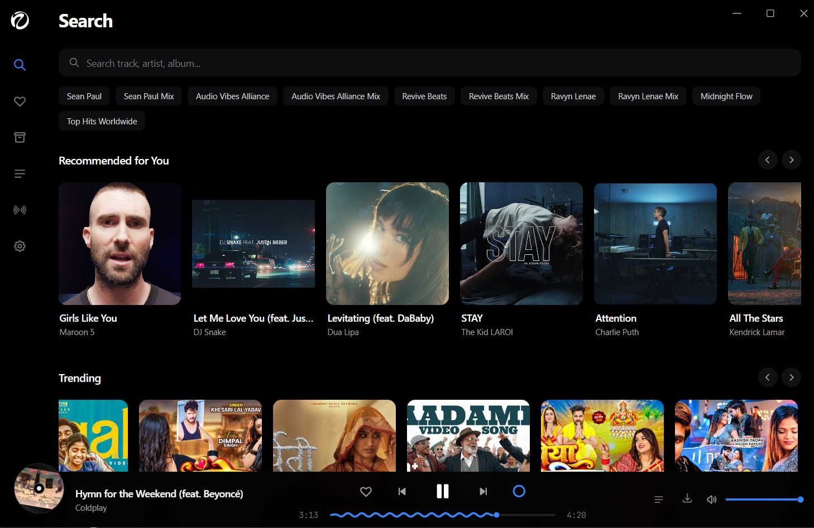
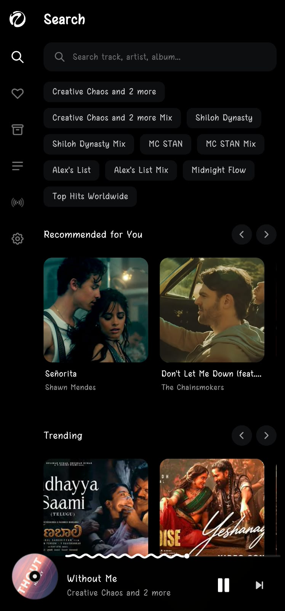

# Vibes

An open-source, ad-free music client inspired by ViMusic. Built with Tauri v2 (Rust) and Svelte 5 to run natively across Android, Windows, macOS, Linux, and iOS while using around 40-50 MB of RAM.

<p align="center">
  
  
</p>

## Highlights

- Ad-free streaming: Clean audio playback from YouTube Music with lockscreen and background controls.
- Automatic offline cache: Streams and saves audio chunks locally simultaneously. Replaying songs uses 0 KB of network data and works offline without manual downloads.
- Real-time P2P Jam sessions: Group listening rooms synced over WebRTC. Share a room code to listen together in sync with guest queue controls and no accounts required.
- Playlist import: One-click import for public YouTube and Spotify playlist URLs.
- Synced karaoke lyrics: Real-time scrolling lyrics powered by LRCLIB with tap-to-seek.
- Lightweight: Native Rust backend paired with Svelte 5 runes. No Electron bloat.
- Privacy first: Zero trackers, zero ads, zero telemetry, and no Google Play Services requirements.

## Downloads (Release v1.0.0)

| Platform | Direct Download | Alternative | Architecture / Notes |
| :--- | :--- | :--- | :--- |
| Android | [Vibes.apk](https://github.com/UnityNimit/Vibes/releases/download/v1.0.0/Vibes.apk) | [Latest Release](https://github.com/UnityNimit/Vibes/releases/latest) | Universal APK (arm64, armv7, x86_64, x86), 16 KB page-aligned |
| Windows Portable | [Vibes.exe](https://github.com/UnityNimit/Vibes/releases/download/v1.0.0/Vibes.exe) | [Latest Release](https://github.com/UnityNimit/Vibes/releases/latest) | Standalone portable executable |
| Windows Installer | [Vibes-setup.exe](https://github.com/UnityNimit/Vibes/releases/download/v1.0.0/Vibes_1.0.0_x64-setup.exe) | [MSI Package](https://github.com/UnityNimit/Vibes/releases/download/v1.0.0/Vibes_1.0.0_x64_en-US.msi) | Setup wizard installer or enterprise MSI |
| macOS Universal | [Vibes.dmg](https://github.com/UnityNimit/Vibes/releases/download/v1.0.0/Vibes.dmg) | [Latest Release](https://github.com/UnityNimit/Vibes/releases/latest) | Universal binary (Apple Silicon M-series and Intel x86_64) |
| Linux AppImage | [Vibes.AppImage](https://github.com/UnityNimit/Vibes/releases/download/v1.0.0/Vibes.AppImage) | [Latest Release](https://github.com/UnityNimit/Vibes/releases/latest) | Standalone Linux executable |
| Linux Debian / Ubuntu | [Vibes.deb](https://github.com/UnityNimit/Vibes/releases/download/v1.0.0/Vibes.deb) | [Latest Release](https://github.com/UnityNimit/Vibes/releases/latest) | Debian package installer |
| iOS | [Vibes.ipa](https://github.com/UnityNimit/Vibes/releases/download/v1.0.0/Vibes.ipa) | [Latest Release](https://github.com/UnityNimit/Vibes/releases/latest) | Sideloadable via AltStore, SideStore, or TrollStore |

## Keyboard Shortcuts

- Space: Play / Pause
- ArrowLeft / ArrowRight: Seek backward / forward 5 seconds
- Ctrl + ArrowLeft / Ctrl + ArrowRight: Previous / Next track in queue
- L: Toggle synchronized karaoke lyrics

## Building From Source

Prerequisites: Node.js 20+, Rust toolchain, and platform build tools (Visual Studio C++ on Windows, Xcode on macOS, or build-essential on Linux).

```bash
# 1. Clone the repository
git clone https://github.com/UnityNimit/Vibes.git
cd Vibes

# 2. Install dependencies
npm install

# 3. Run development mode
npm run tauri dev

# 4. Build standalone production binary
npm run tauri build
```

For Android APK builds:
```bash
npx tauri android build --apk
```

## Star History

<a href="https://star-history.com/#UnityNimit/Vibes&Date">
  <picture>
    <source media="(prefers-color-scheme: dark)" srcset="https://api.star-history.com/svg?repos=UnityNimit/Vibes&type=Date&theme=dark" />
    <source media="(prefers-color-scheme: light)" srcset="https://api.star-history.com/svg?repos=UnityNimit/Vibes&type=Date" />
    
  </picture>
</a>

## License

This project is licensed under the [MIT License](LICENSE).
